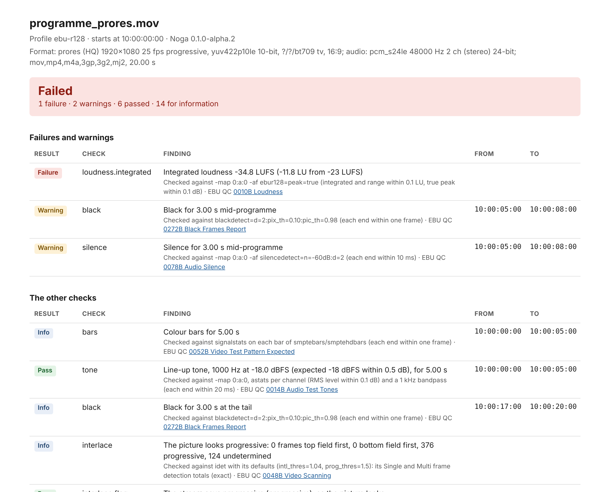
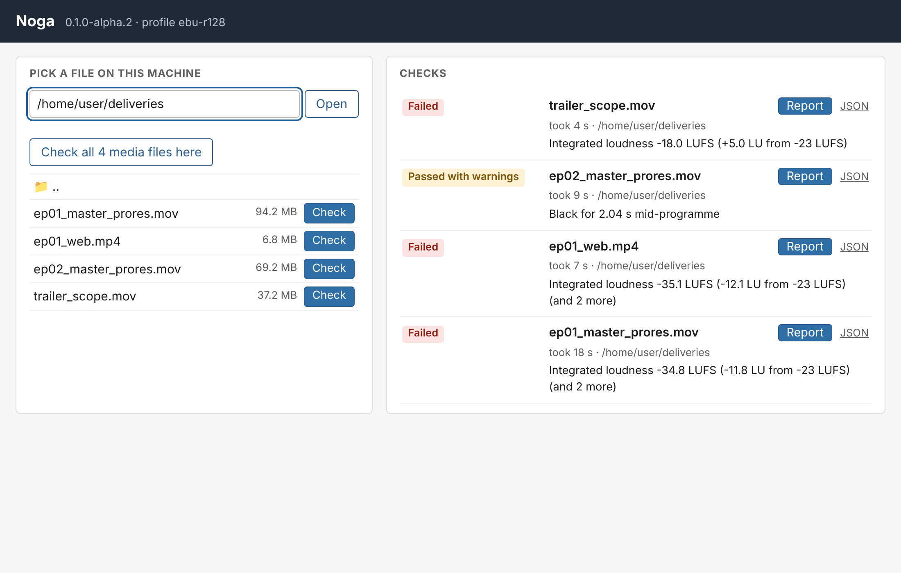
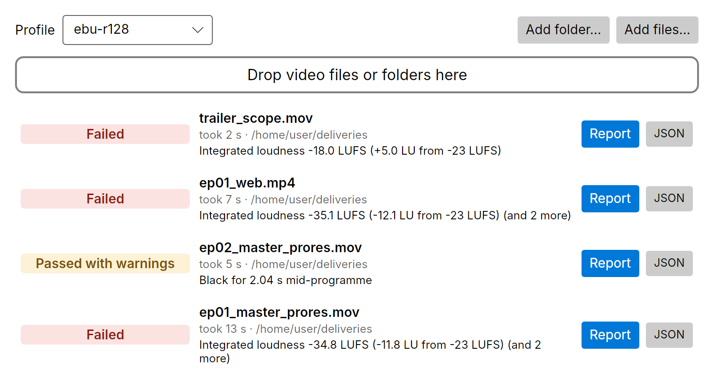

# Noga

File-based quality control of video deliveries: a cheap, local, scriptable first pass before files go to a
broadcaster or platform. Point it at a file and you get one report (HTML, JSON and an exit code for pipelines) of
its loudness, black, frozen pictures, colour bars, line-up tone, silences, audio channels, pixels outside broadcast
range, crop, interlacing, frame types, bitrate, keyframes, format and shot list, with timecodes. Every figure says
how it is checked against FFmpeg, and a test checks it.

*Noga* is Swedish for careful, thorough. It is for small post houses, freelancers and archives. It runs on your
machine and the files stay there. It is not a replacement for Netflix's or the DPP's compliance checks: it catches
the common faults earlier, before a delivery bounces.



An example report: [HTML](docs/example/programme_prores.mov.qc.html) (download it to view it) and
[JSON](docs/example/programme_prores.mov.qc.json), from `tools/make-samples.sh`'s ProRes programme.

## What it checks

Each figure is computed in-process and checked, in this repository's tests, against the `ffmpeg` command line.

| Check | What it reports | Checked against |
| --- | --- | --- |
| Loudness | integrated (fails outside the profile's target), loudness range, true peak; measured after the line-up tone | `ebur128=peak=true`: within 0.1 LU, true peak within 0.1 dB |
| Black | spans of black: a warning mid-programme, reported at the head and tail | `blackdetect=d=2:pix_th=0.10:pic_th=0.98`: each end within one frame |
| Frozen pictures | a picture frozen for 2 s or more (black and bars left out) | `freezedetect=n=0.001:d=2`: each end within one frame |
| Colour bars | SMPTE bars and where they are | `signalstats` on each bar |
| Line-up tone | 1 kHz tone, its level judged (-18 dBFS EBU, -20 dBFS ATSC) | `astats` and a 1 kHz bandpass |
| Silence | spans of silence: a warning mid-programme | `silencedetect=n=-60dB:d=2`: each end within 10 ms |
| Audio channels | dead (fails), silent, out of phase, clipping (warnings), dual mono, on every track | `astats`, `aphasemeter` |
| Broadcast range | pixels outside 16-235 (chroma 16-240), scaled to the bit depth | `signalstats` BRNG, exact |
| Crop | letterbox and pillarbox | `cropdetect`, exact |
| Interlacing | whether the picture looks interlaced, against the stream's field order | `idet`'s totals, exact |
| Format | container, codec and profile, size, rate, scan, colour, bit depth, every audio track, duration; a profile can require each | `ffprobe`, exact |
| Frames, keyframes, bitrate | picture types, keyframe positions, bytes a second | `ffprobe -show_frames`, `-show_packets`, exact |
| Head and tail | a profile can require bars, tone and black at the head and black at the tail | as above |
| Decoding | a picture that ends before the frames the file lists, frames that don't decode, a track whose sound ends early: each fails (MOV, MP4, MXF) | `ffprobe -count_packets -count_frames` (`nb_frames`, `nb_read_packets`, `nb_read_frames`), exact; the sound against `astats`' samples |
| Shot list | the cuts | PySceneDetect's `detect-adaptive`, through [ShotDetector](https://github.com/bisforboman/shotdetector) |

Each finding also names its [EBU QC](https://qc.ebu.io) item. Timecodes run from the file's start timecode,
drop-frame at 29.97 and 59.94.

It reads ProRes and DNxHR in MOV and MXF, H.264 in MP4, and whatever else FFmpeg reads. H.264 and AAC in MP4 are
decoded in managed code ([ManagedCodecs](https://github.com/bisforboman/ManagedCodecs)); everything else goes
through FFmpeg's libraries, which come with Noga. A test checks that both paths give the same figures on the same
file.

## Install

Download a release from the [Releases page](../../releases). Each holds the `noga` command, the desktop app
`noga-app`, the .NET runtime and FFmpeg's libraries. Nothing else is needed.

- **Windows (x64)**: `noga-VERSION-win-x64-setup.exe` installs for your user, without administrator rights. It adds
  Start-menu shortcuts and, if you choose, puts `noga` on your PATH. Or unpack `noga-VERSION-win-x64.zip`.
- **Linux (x64, arm64)**: `noga-VERSION-x86_64.AppImage` or `noga-VERSION-aarch64.AppImage`. Run `chmod +x` on it,
  then run it. On its own it opens the app; with `check`, `serve`, `--help` or `--version` it runs the command. Or
  unpack the `.tar.gz` and run `./install-desktop-entry.sh` to add the app to the desktop's menu.
- **macOS**: not yet.

The releases are not signed yet, so Windows SmartScreen will warn the first time you run one.

## Use

```bash
noga check episode01.mov
```

This writes `episode01.mov.qc.html` and `episode01.mov.qc.json` next to the file (or in `--out FOLDER`) and prints
the findings:

```
programme_prores.mov: Failure (profile ebu-r128, exit code 1)
  Pass     tone: Line-up tone, 1000 Hz at -18.0 dBFS (expected -18 dBFS within 0.5 dB), for 5.00 s [10:00:00:00-10:00:05:00]
  Warning  black: Black for 3.00 s mid-programme [10:00:05:00-10:00:08:00]
  ...
  Failure  loudness.integrated: Integrated loudness -34.7 LUFS (-11.7 LU from -23 LUFS)
  Pass     loudness.true-peak: True peak -24.1 dBTP (at most -1.0 dBTP)
```

The exit code is for pipelines: **0** passed, **1** failed, **2** a usage or read error, **3** warnings (or 1 with
`--warnings-fail`).

On a 4-core machine, the 20 s 1080p 10-bit ProRes programme above takes about 7 s to check.

### Profiles

`--profile` picks what the file is judged by:

- `ebu-r128` (the default): -23 LUFS within 0.5 LU, true peak -1 dBTP
- `atsc-a85` (US): -24 LKFS within 2 LU, -2 dBTP
- `op-59` (Australia): -24 LKFS within 1 LU, -2 dBTP
- `arib-tr-b32` (Japan): -24 LKFS within 1 LU, -1 dBTP
- delivery templates: `hd-1080i25-prores-hq`, `hd-1080p25-prores-hq`, `web-1080p-h264-aac`
- your own `.json` file: a name, the profile it is `basedOn`, the thresholds it changes, and in `format` what the
  delivery asks for. Each value given fails the file when it differs.

```json
{
  "name": "channel-x-hd",
  "basedOn": "ebu-r128",
  "maxTruePeak": -2,
  "headBars": 30, "headTone": 30, "headBlack": 10, "tailBlack": 5,
  "format": { "videoCodec": "prores", "videoProfile": "HQ", "width": 1920, "height": 1080, "frameRate": "25",
              "scan": "interlaced", "audioTracks": 1, "audioChannels": 2, "startTimecode": "10:00:00:00" }
}
```

The release's `profiles/` folder has the templates to copy from. `noga --help` lists every profile with its figures.

### The web UI

```bash
noga serve
```

This opens a page on `http://localhost:8722` where you pick files on the machine and check them, one at a time; the
reports are written beside each file. `--watch FOLDER` also checks every media file copied into FOLDER.
`--listen 0.0.0.0:8722 --root FOLDER` shares it with your team over HTTPS: only the `--root` folders are visible, and
only to whoever opens the link it prints, which carries a token.



### The desktop app

`noga-app` opens a window to drop files or folders on. Each is checked where it is, with the profile chosen in the
window.



## Build from source

You need the .NET 10 SDK. The tests also need `ffmpeg` on PATH (with libx264 for the MP4 sample) and bash.

```bash
tools/make-samples.sh          # the test files, into samples/ (~45 s, ~480 MB; the tests make them if missing)
dotnet test Noga.slnx
dotnet run --project src/Noga.Cli -- check samples/programme_prores.mov
tools/publish.sh               # the release builds and installers, into artifacts/
```

No media is committed: the test files are generated from FFmpeg's test sources, and the weekly film tests download
Blender's open films, pinned by SHA-256. Design decisions are in [docs/decisions/](docs/decisions/), what comes next
in [docs/backlog.md](docs/backlog.md).

## Licence

MIT: [LICENSE](LICENSE). Noga is free to use, commercially too. Support, integration and custom profiles are
available from the author.

The libraries it ships keep their own licences: [docs/dependencies.md](docs/dependencies.md). FFmpeg's libraries
(LGPL 2.1 or later) and ShotDetector.FastYuv (LGPL) are separate, replaceable files, and their licences and sources
ship with them. Nothing in it is GPL.
